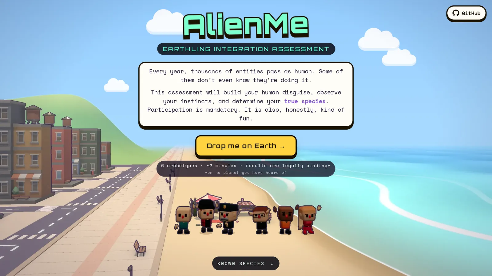
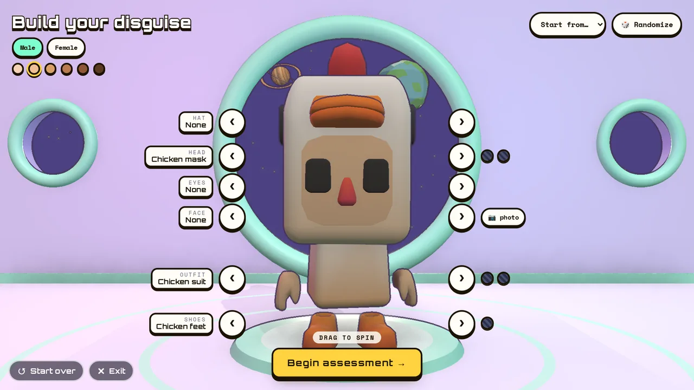
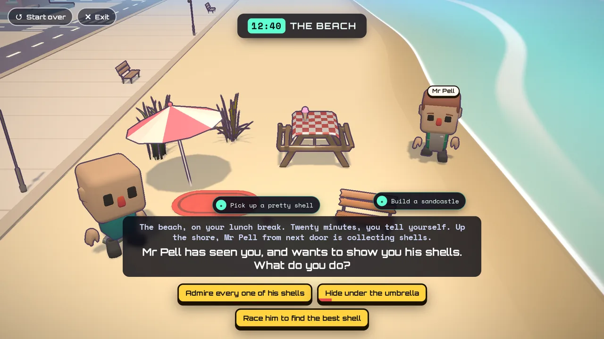
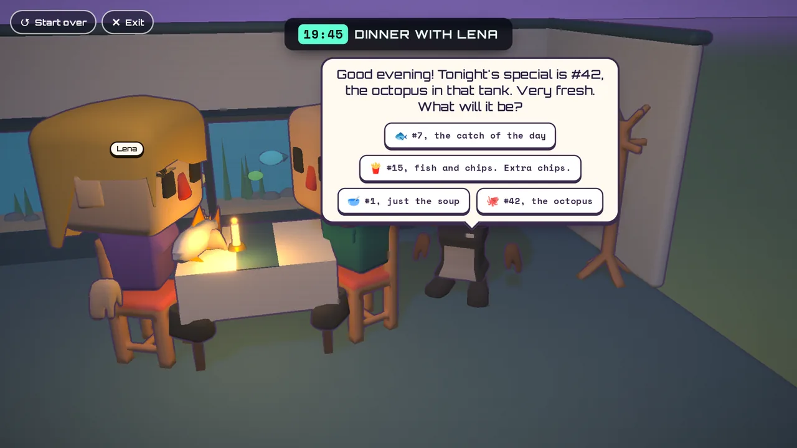
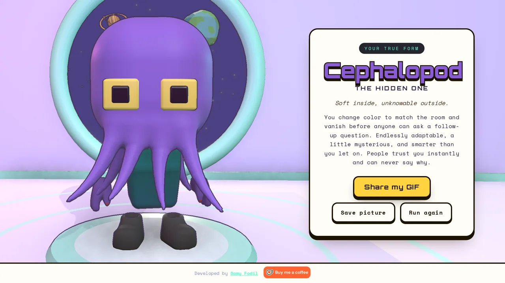

# AlienMe

**Are you one of us?** A 3D browser game: build a human disguise, live one
ordinary day on Earth, and find out which of six aliens you really are.



1. **Build your disguise.** Pick a body, skin tone, head, outfit and shoes from
   a cast of chibi characters, or put your own face on it from a photo.
2. **Live the day.** The day is a graph of small 3D rooms: your bedroom, the
   bus stop, the office, the beach, the arcade, dinner, and a party invite
   waiting on your phone. Each room asks a question or two, and
   every answer nudges you toward one of the aliens. Some people you meet are
   cast at random (and stay the same for the whole day).
3. **The reveal.** Your human head lifts off and your real one rises from the
   collar: Grey, Avian, Reptilian, Cephalopod, Mantis or Tall White. You get a
   share card and a GIF of the moment.

<p align="center">
  
  
  
  
</p>

The alien heads are built in code. Everything else is low-poly models from the
artists listed in [CREDITS.md](CREDITS.md).

## Like it?

If AlienMe made you smile, please ⭐ star the repo: it helps other people find
it. And if you'd like to buy me a coffee:

<a href="https://ko-fi.com/Q0I22A5DLG"></a>

## Run it

```bash
npm install
npm run dev        # http://localhost:5173
npm run build      # static site in dist/
npm run preview    # serve dist/
```

`base: './'` in `vite.config.js` makes the build work from any static host or
subpath (GitHub Pages included).

## Writing the story

The whole day is data, in [`src/data/story3d.ts`](src/data/story3d.ts). The
notes at the top of that file describe the format: rooms, questions, answers,
flags, ways between rooms, the cast. The engine in `src/story/` has no story of
its own.

While `npm run dev` runs:

- the story is checked on every reload, and any errors show over the day;
- [`/storymap.html`](http://localhost:5173/storymap.html) draws the day as a
  map, where any room can be played with any flags;
- `?story=<room id>` starts the day in that room.

From the command line:

- `npm run story:check` plays out every state of the day looking for errors,
  then counts every combination of answers with the Go counter in
  `tools/storycount` (needs Go) to check that each alien wins an even share,
  16.7% ± 2%. The count is exact and heavy: several GB of memory and about ten
  minutes.
- `npm run story:play [seed] [room] [extras]` plays one day in a headless
  browser and writes a log of what happened, with screenshots, to a temp
  folder.
- `npm test` typechecks and runs the same balance count as a test.

## Where things live

| Path | What |
| --- | --- |
| `src/screens/` | Intro, Builder, Story3D, Reveal, plus dev views (Lineup, Inspector, Specimen, Town) |
| `src/story/` | Story engine, checker, rooms, player, answer cards, phone |
| `src/three/` | Characters, NPCs, props, alien heads, post effects, quality scaling |
| `src/data/` | Aliens, avatar parts, props, room sets, the story |
| `public/models/` | `cutes/` characters and cars, `scenes/` props (each listed in `MANIFEST.json`) |
| `tools/storycount/` | The Go counter behind `story:check` |
| `scripts/` | Story check, headless play, image rendering |

Built with React 18, three.js, react-three-fiber, drei, postprocessing,
zustand and Vite.

## Licence

```
AlienMe: a 3D browser game about finding the alien in you.
Copyright (C) 2026 Samy Fodil

This program is free software: you can redistribute it and/or modify
it under the terms of the GNU Affero General Public License as published by
the Free Software Foundation, either version 3 of the License, or
(at your option) any later version.

This program is distributed in the hope that it will be useful,
but WITHOUT ANY WARRANTY; without even the implied warranty of
MERCHANTABILITY or FITNESS FOR A PARTICULAR PURPOSE.  See the
GNU Affero General Public License for more details.

You should have received a copy of the GNU Affero General Public License
along with this program.  If not, see <https://www.gnu.org/licenses/>.
```

The full licence text is in [LICENSE](LICENSE) (`AGPL-3.0-or-later`). The 3D
models are not covered by it: they keep their own licences (CC BY 3.0 and
CC0), listed in [CREDITS.md](CREDITS.md).
